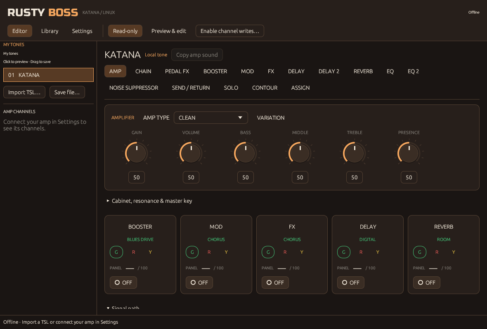

# Rusty Boss

> **Warning: AI-generated project.** Rusty Boss was developed using AI-generated
> code and is experimental. It has not undergone a comprehensive independent code
> or hardware-safety audit. Bugs could change your amp's sound or overwrite saved
> tones. Make a known-good backup with BOSS Tone Studio before use, review the
> code and behavior carefully, and use it at your own risk.

### Your Katana. Your tones. On Linux.

Rusty Boss is a Linux app for editing **BOSS KATANA amplifiers** and organizing
presets. Shape your sound with amp knobs and effect controls, try downloaded tones,
and save your favorites straight to your amp—without Wine or Windows.

**Currently supports KATANA Gen 3.** MkI and MkII amps and preset conversion are
outside this app's scope.



## Play first, save when you're ready

1. **Connect your amp by USB.** In **Settings**, refresh the MIDI ports, choose
   the Katana's control port, and click **Connect**.
2. **Import your tones.** Click **Import TSL…** and choose a Gen 3 `.tsl` file.
   You can also drop the file onto the app window. Each import adds a collection;
   your existing tones are kept.
3. **Choose “Preview & edit.”** Click a tone in **My tones** to hear it on your
   amp. Amp knobs and effects become live after the preview is read back.
   Click another tone to try it. **Your saved channels are unchanged.**
4. **Keep a favorite.** Click **Enable amp writes…** and answer **Yes**.
   Drag a tone from **My tones** onto an **Amp channel**, then answer **Yes** to
   the overwrite confirmation. That's it—no typed unlock phrases and no manual
   buffer-commit steps.
5. Click **Amp writes enabled · Lock** when you're done saving.

Saving a channel changes the amp's current sound and replaces that channel's
previous tone. The app saves the tone you dragged, not an unrelated sound that
happens to be in the amp buffer. **PANEL is also a selectable save destination.**

> **Keep a backup.** Hardware support is still experimental. Make a known-good
> backup with BOSS Tone Studio before overwriting channels, and don't use Rusty
> Boss as your only backup tool. If a save fails or the USB connection drops, the
> amp's state may be unknown—check it rather than blindly retrying.

## Protection that stays visible

The controls at the top tell you what the app is allowed to change:

| Mode | What it does |
|---|---|
| **Read-only** | Browse tones locally and read the amp. Clicking a tone does not change the amp's sound. Preview, live knobs, channel switching and saved-channel writes are blocked. |
| **Preview & edit** | Click a tone to hear it and adjust the current sound. Saved channels remain protected. |
| **Amp writes enabled** | Allows confirmed channel saves, system-setting Apply and full restore. Each destructive operation still asks first. |

The app starts in **Read-only** every time. It never connects automatically and
never remembers permission to write. Connecting in read-only still sends the
editor-session setup/cleanup commands needed by the connection; it does not
change tone parameters or select a channel.

## A focused editor

- **Editor:** familiar amp knobs, colored effect banks, algorithm-specific
  controls, EQ, delay, reverb, solo, contour and signal routing. No Raw/Regular
  mode switch.
- **My tones + Amp channels:** a single place to choose, audition and drag-save
  presets. Channel names are read when you connect; available channels follow
  your amp model. Clicking a channel copies it locally in read-only mode; in
  preview mode it switches the amp to that saved sound.
- **Library:** automatically saved collections; rename, annotate, duplicate,
  reorder or delete tones. Open **Select & transfer tones** for multiselect,
  collection-to-collection copy/move and selected amp-channel import/export.
- **Settings:** connection and appearance up front. **Amp settings** and
  **Backup & channel reads** stay collapsed until you need them. There are no
  extra top-level tabs or raw parameter screens.

Turn a knob by dragging up/down. Focus it and use arrow keys for small changes,
or click the value to type an exact number. Effect cards and section buttons
open the corresponding controls. In **CHAIN** or **Signal path**, drag a movable
block onto another block to place it immediately after that block. Legal targets
are highlighted; unsupported routes are not applied. Right-click a movable block
for its available destinations, or use the chain-pattern/position selectors.

**Copy amp sound** reads the current sound into a new local tone—it does not
replace the downloaded tone you were editing. In **Settings → Backup & channel
reads**, you can copy an individual saved channel without switching the amp,
read a full backup, open/save `.alb` files, and recover individual tones.
**Restore full backup…** replaces system settings, PANEL and all saved channels;
only backups from the exact connected model are accepted. Restore is experimental
and hardware-unverified. Cancellation is not rollback: keep a separate known-good
backup and do not retry a failed restore blindly.

### PANEL support today

Click **PANEL** under **Amp channels** to select it (or copy it locally in
read-only mode). To save your chosen effects and assignments, edit a local tone,
enable channel writes, drag it onto **PANEL**, and confirm the overwrite.
This saves the whole tone snapshot, not just one effect. Physical knobs can
override panel-controlled values; reboot persistence has not been independently
hardware-tested. The effect cards' **PANEL** knobs become editable after preview.
These are firmware macros, not aliases for Effect Level; related parameters are
read back after a completed gesture. Device watcher notifications update them
while live, but they are not continuously polled physical-position meters.

### Collections, files and amp channels

- Collections save locally about every 750 ms while changed and on normal close.
  The data file is `$XDG_DATA_HOME/rusty-boss/library.json` (normally
  `~/.local/share/rusty-boss/library.json`). A previous copy is retained beside it.
  Save errors stay visible; never discard work after a save error without exporting it.
- **Export TSL…** shares the current collection as a Gen 3 `.tsl` file.
  It does **not** write to the amplifier. Importing a TSL adds a new collection.
- **Drag a tone onto an Amp channel** to save it on the amplifier. For several
  tones, use **Library → Select & transfer tones**; destinations are listed before
  you confirm. Earlier successful saves are not undone if a later save fails.
- The local library is currently bounded to 16 MiB, with up to 100 collections
  and 1,000 tones per collection. Export/remove unused collections if it fills up.
  A crash before the next autosave can still lose the most recent edits.

### The advanced controls, without an advanced app

- **Settings → Amp settings:** read the amp, choose Global EQ, Outputs, USB,
  MIDI or Foot control, then **Apply to amp…**. Changes are staged locally until
  Apply; stale externally changed settings are rejected before writes begin.
- **Editor → ASSIGN:** select panel knobs, the amp pedal/footswitch, GA-FC/EX
  or an expanded controller. Targets follow the active algorithm; expression
  heel/toe ranges use its units and can be reversed. Changing a target resets its range.
- Delay, Delay 2 and supported solo-delay pages have **Tap tempo**.
  Reverb/Delay 2 pages expose their shared layer mode.
- **Icon…** on an effect page lets you choose a local PNG, up to 512 × 512 pixels
  and 2 MiB, for that algorithm. It changes the cards/chain, not your tone or amp.

Marketplace integration, legacy-preset conversion, localization and bundled
manuals are intentionally not part of Rusty Boss.

## Four looks, one app

Choose a theme in **Settings → Appearance**. Your choice is remembered.

| Theme | Look |
|---|---|
| **Puppet** — default | Warm copper/orange accents over earth-toned surfaces and controls. |
| **Justice** | Pearl-white surfaces with pale mint/sage accents. The only light theme. |
| **Kill** | Crimson accents and deep red-black surfaces. |
| **Lightning** | Metallic steel-blue surfaces and accents mixed with purple selections and highlights. |

[Justice](docs/screenshots/justice.png) · [Kill](docs/screenshots/kill.png) · [Lightning](docs/screenshots/lightning.png)

## Run on Linux

From a source checkout, with Rust 1.99.1 or newer, a C toolchain and ALSA development packages installed:

```sh
cargo build --release --locked
./target/release/rusty-boss
```

The app supports **native Wayland** as well as X11. On a Wayland desktop it
prefers Wayland directly; XWayland is not required. Native file choosers use your
desktop's XDG portal. A working graphical Linux
desktop and ALSA USB-MIDI support are required. See [build instructions](docs/DEVELOPMENT.md)
for distribution packages, offline builds, tests and troubleshooting details.

### Amp not showing up?

- Click **Refresh MIDI ports**; the list is not scanned at startup.
- Check the USB cable and that Linux exposes the Katana as an ALSA MIDI device.
  Choose the **MIDI control port**, not an audio device.
- Close other MIDI editors that might have exclusive access to the port.
- Check your distribution's sound-device permissions. Don't run the app as root
  or make sound devices world-writable.

Rusty Boss controls the amp's own sound engine. It is not an audio driver, an amp
simulator, or a DAW, and it does not configure your system's USB-audio routing.

## About

Rusty Boss is an independent Linux editor, not an official Roland/BOSS product.
We study device behavior and compatible file formats to make the amp useful on
Linux; the goal is a friendly editor, not a one-to-one copy of Tone Studio.
Original vendor artwork, application JavaScript and native libraries are not part
of the app's runtime.

For contributors: [development](docs/DEVELOPMENT.md) · [supported features and gaps](docs/PARITY.md)
· [technical investigation](docs/INVESTIGATION.md) · [preset workflow evidence](docs/PRESET-WORKFLOW.md)
· [1.0.0 changes](CHANGELOG.md) · [release checklist](docs/RELEASE.md)
· [notices](NOTICE.md) · [GPLv3 licensing review](docs/LICENSE-REVIEW.md).
